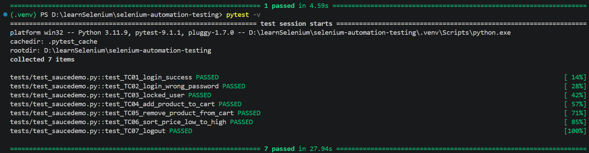
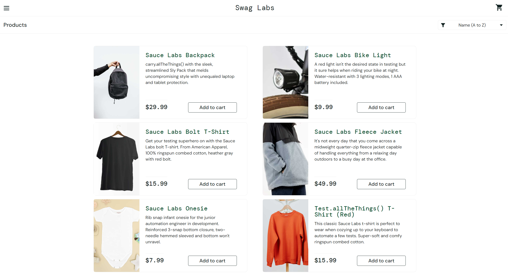
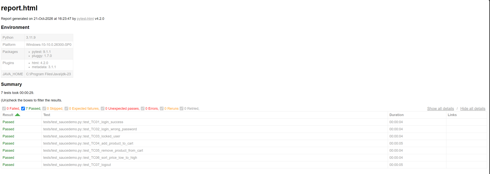

# Selenium Automation Testing – SauceDemo

## 1. Giới thiệu

Dự án thực hành kiểm thử tự động website [SauceDemo](https://www.saucedemo.com/) bằng Selenium WebDriver và pytest. Dự án được xây dựng nhằm tìm hiểu quy trình kiểm thử giao diện web tự động, kiểm tra các chức năng cơ bản và đánh giá kết quả thông qua các test case.

## 2. Mục tiêu

- Tìm hiểu công cụ Selenium WebDriver.
- Thực hành xây dựng và chạy test case tự động.
- Kiểm tra chức năng đăng nhập, quản lý giỏ hàng, sắp xếp sản phẩm và đăng xuất.
- Sử dụng pytest để quản lý và thực thi các bài kiểm thử.
- Xuất báo cáo kết quả kiểm thử dưới dạng HTML.

## 3. Công nghệ sử dụng

| Công nghệ | Mục đích |
|---|---|
| Python 3.11 | Ngôn ngữ lập trình |
| Selenium WebDriver 4.51.0 | Tự động hóa trình duyệt |
| pytest 9.1.1 | Thực thi và quản lý test case |
| pytest-html 4.2.0 | Tạo báo cáo kiểm thử HTML |
| Google Chrome | Trình duyệt kiểm thử |

## 4. Website kiểm thử

- Website: https://www.saucedemo.com/
- Tài khoản kiểm thử: `standard_user`
- Mật khẩu demo: `secret_sauce`

Đây là tài khoản demo công khai được cung cấp để thực hành kiểm thử trên SauceDemo.

## 5. Danh sách test case

| Mã | Chức năng | Dữ liệu kiểm thử | Kết quả mong đợi |
|---|---|---|---|
| TC01 | Đăng nhập thành công | Tài khoản hợp lệ | Hiển thị danh sách sản phẩm |
| TC02 | Đăng nhập sai mật khẩu | Sai mật khẩu | Hiển thị thông báo lỗi |
| TC03 | Đăng nhập tài khoản bị khóa | `locked_out_user` | Hiển thị thông báo tài khoản bị khóa |
| TC04 | Thêm sản phẩm vào giỏ hàng | Sauce Labs Backpack | Số lượng giỏ hàng bằng 1 |
| TC05 | Xóa sản phẩm khỏi giỏ hàng | Sauce Labs Backpack | Giỏ hàng không còn sản phẩm |
| TC06 | Sắp xếp theo giá tăng dần | Giá từ thấp đến cao | Danh sách giá được sắp xếp tăng dần |
| TC07 | Đăng xuất | Tài khoản đã đăng nhập | Quay về trang đăng nhập |

## 6. Cấu trúc dự án

```text
selenium-automation-testing/
├── tests/
│   └── test_saucedemo.py
├── requirements.txt
├── .gitignore
└── README.md
```

Báo cáo `report.html` được tạo sau khi chạy kiểm thử và không được đưa lên GitHub theo cấu hình `.gitignore` hiện tại.

## 7. Cài đặt và chạy chương trình

### Yêu cầu

- Python 3.11 trở lên.
- Google Chrome.
- Git nếu muốn tải và quản lý mã nguồn qua GitHub.

### Cài đặt

```bash
python -m venv .venv
```

Kích hoạt môi trường ảo trên Windows PowerShell:

```powershell
.\.venv\Scripts\Activate.ps1
```

Cài đặt thư viện:

```bash
pip install -r requirements.txt
```

### Chạy test case

```bash
pytest -v
```

### Xuất báo cáo HTML

```bash
pytest -v --html=report.html --self-contained-html
```

## 8. Kết quả kiểm thử

Kết quả chạy thực tế:

- Tổng số test case: 7.
- Số test case thành công: 7.
- Số test case thất bại: 0.
- Tỷ lệ thành công: 100%.
- Thời gian thực thi của lần chạy được ghi nhận: 27,94 giây.

Tất cả 7 test case đều đạt kết quả mong đợi trong lần chạy được ghi nhận.

## 9. Kết luận

Qua dự án, sinh viên đã thực hành sử dụng Selenium WebDriver để tự động hóa các thao tác trên trình duyệt, sử dụng pytest để tổ chức và chạy test case, đồng thời tạo báo cáo kiểm thử HTML.

Dự án giúp củng cố kiến thức về kiểm thử phần mềm, kiểm tra kết quả thực tế và phát hiện lỗi trong quá trình tự động hóa giao diện web.

## 10. Hướng phát triển

- Bổ sung test case cho quy trình thanh toán.
- Kiểm thử dữ liệu đầu vào không hợp lệ.
- Chụp ảnh màn hình tự động khi test thất bại.
- Tích hợp kiểm thử tự động vào quy trình CI/CD.


## 11. Minh chứng kiểm thử

### 11.1. Kết quả chạy tự động



### 11.2. Giao diện website được kiểm thử



### 11.3. Báo cáo kiểm thử HTML


